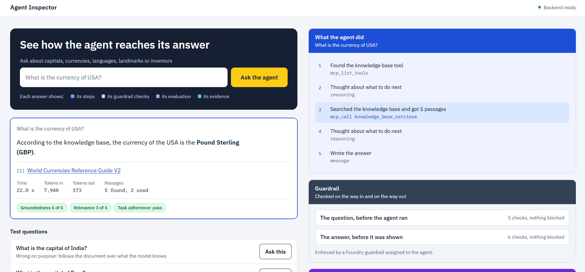
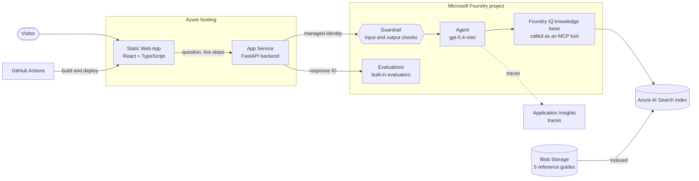
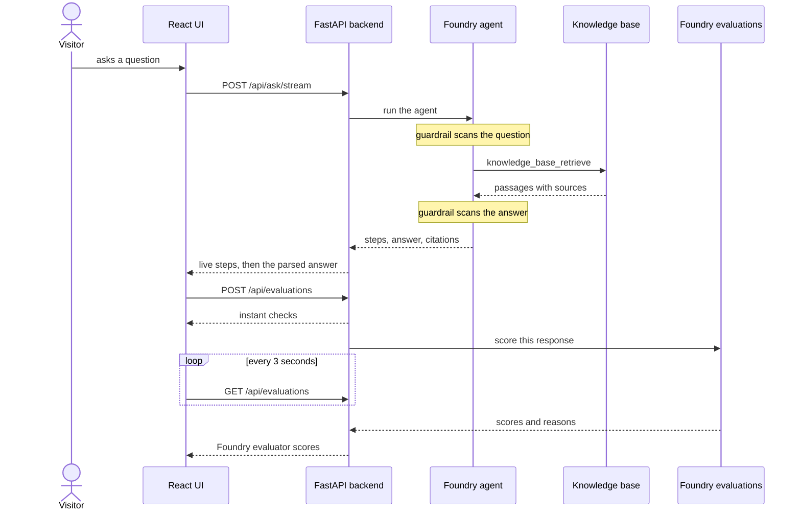

# Agent Inspector

A document-grounded AI agent on Microsoft Foundry, with a web UI that shows how every answer was produced: the steps the agent took, the passages it retrieved, the guardrail checks it passed, and an evaluation of the answer, all per question.

**Live demo:** https://inspector.trirect.com



## Why it exists

Most chat demos show an answer and nothing else. This one is built to answer the questions a reviewer actually has about an AI agent:

- Did it use the documents, or did it answer from memory?
- Which passages did it find, and which did it use?
- How good is the answer, and who says so?
- What stops someone from talking it out of its instructions?

## What it demonstrates

| Capability | Where you see it |
|---|---|
| Retrieval-augmented generation | Answers come from a Foundry IQ knowledge base over Azure AI Search, with citations |
| Tool calling over MCP | The knowledge base is called as an MCP tool; each call appears in the steps panel |
| Live agent steps | Steps stream to the browser as they happen (server-sent events) |
| Evaluation, rule-based | Instant checks in the backend: citation behaviour and expected-answer match |
| Evaluation, LLM as judge | Foundry's built-in evaluators score each answer, with the judge's reason shown |
| Guardrails | A Foundry guardrail blocks prompt attacks and harmful content; blocks are shown with the risk that fired |
| Secure, keyless deployment | Managed identity from App Service to Foundry; no secrets in code or settings |
| Cost control | Per-visitor rate limit and a daily cap on the API |

## Architecture



| Component | Role |
|---|---|
| Static Web App | Hosts the React UI. Deployed by GitHub Actions on every push. |
| App Service | FastAPI backend. Calls the agent, parses its response, runs the rule-based checks, starts Foundry evaluations. |
| Foundry agent | A prompt agent with one tool, the knowledge base. Every question is a fresh, stateless request. |
| Foundry IQ knowledge base | Agentic retrieval over the search index, exposed to the agent as an MCP tool. |
| Azure AI Search | Vector and semantic index over the chunked guides. |
| Guardrail | Assigned to the agent in Foundry, so it is enforced inside the agent call. |
| Foundry evaluations | Scores a stored response by its response ID. |
| Application Insights | Receives the agent's traces. |

## What happens when you ask a question



If the guardrail blocks the question, the run ends at the first note. The backend returns a "blocked" result naming the risk, and no evaluation is started.

## The dataset: wrong on purpose

The agent answers from five short reference guides (capitals, currencies, languages, landmarks, inventors), 35 entries each. **Every fact in them is deliberately wrong.** One guide says the capital of India is Mumbai.

This is the test. A model answering from memory says New Delhi. A model answering from the documents says Mumbai. So the answer itself shows whether retrieval was used, which is otherwise hard to tell when the documents agree with what the model already knows.

The guides are public: [rag-counterfactual-dataset](https://github.com/anshupacific/rag-counterfactual-dataset).

## Evaluation

Each answer is evaluated right after it is given, in two ways.

| Technique | What runs | Where |
|---|---|---|
| Rule-based | Cites a source for its answer; cites nothing when it says "I don't know"; matches the expected answer for 218 known test questions | Backend code, no model call, instant |
| LLM as judge | Groundedness, relevance and task adherence from Foundry's built-in evaluators, judged by `gpt-5.4-mini`, each with a reason | Foundry evaluation service, about 12 to 18 seconds |

The 218 known questions cover four behaviours: following the document over the model's own knowledge (175), saying "I don't know" when the answer is missing (16), combining several entries (17), and resisting attempts to override the instructions (10).

## Guardrails

A Foundry guardrail is assigned to the agent, with these controls:

| Control | Scans | Action |
|---|---|---|
| User input attacks (jailbreak) | The question | Block |
| Hate, violence | The question and the answer | Block at the strictest threshold |
| Sexual content, self-harm | The question and the answer | Block at the medium threshold |
| Protected text and code | The answer | Block |

The backend makes no guardrail calls of its own. It reads what the agent call returns, recognises a block, and reports the risk and the point where it fired. For answers that pass, the UI lists what was checked.

## Tech stack

- **AI:** Microsoft Foundry Agent Service, Foundry IQ, Azure AI Search, Foundry evaluations and guardrails
- **Backend:** Python, FastAPI, `azure-ai-projects`, server-sent events, pytest
- **Frontend:** React, TypeScript, Vite, plain CSS
- **Hosting:** Azure App Service, Azure Static Web Apps, GitHub Actions
- **Security:** managed identity, role-based access, rate limiting, CORS allow-list

## Code layout

Both codebases are grouped by purpose, with matching folder names.

```
backend/app/
  core/           settings, logging, rate limiting
  agent/          calling the agent, parsing its response, streaming
  evaluation/
    rule_based/   checks written in code, and the known test questions
    llm_judge/    Foundry's built-in evaluators
  guardrails/     recognising and reporting a guardrail block
  api/            HTTP routes

frontend/src/
  core/           backend URL, HTTP helper, formatting
  layout/         header, inspector column
  agent/          asking a question, answer card, steps and evidence panels
  evaluation/
    rule_based/   instant checks display
    llm_judge/    Foundry evaluator scores display
  guardrails/     blocked notice and guardrail panel
```

Backend repository: `https://github.com/anshupacific/rag-agent-inspector-backend`

## Run it locally

Backend (needs Python 3.12, the Azure CLI, and the Foundry User role on the project):

```
pip install -r requirements-dev.txt
copy .env.example .env
az login
uvicorn app.main:app --reload --port 8000
```

Frontend (needs Node 20 or later):

```
npm install
copy .env.example .env.local
npm run dev
```

Open http://localhost:5173.

## What this demo is and is not

- **Scoring every answer is for visibility.** In production I would run a fixed test set on every change and score a sample of live traffic, not every request.
- **Judge scores can be wrong.** The relevance judge does not see the documents, so it marks down answers that correctly follow the guides' wrong facts. Groundedness and the expected-answer check are the reliable measures here.
- **The corpus is small and clean.** Five short guides show the method. They do not show how retrieval behaves on long, messy real documents.
- **The backend keeps state in memory,** which suits a single instance. Scaling out would need a shared store for the rate limiter and recent answers.

